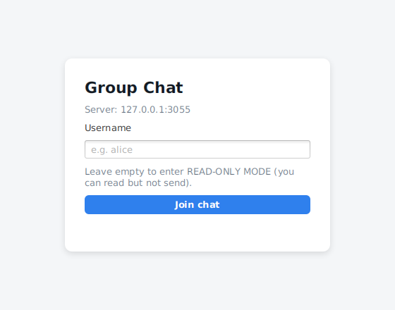
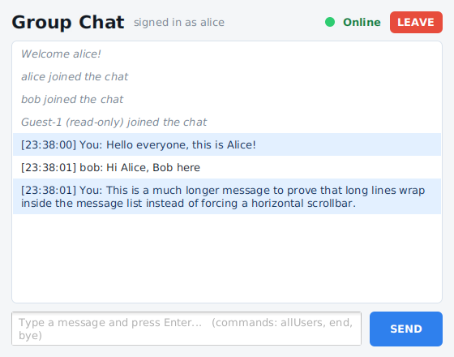
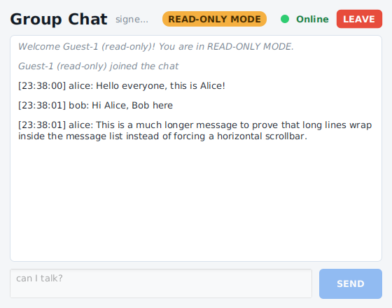
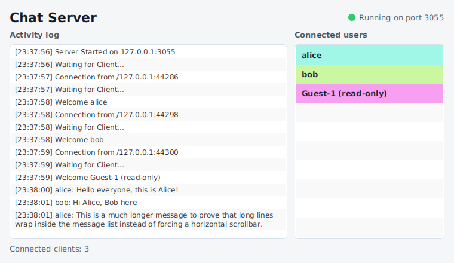
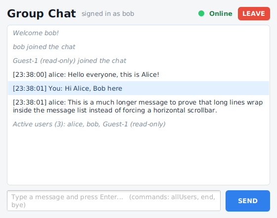
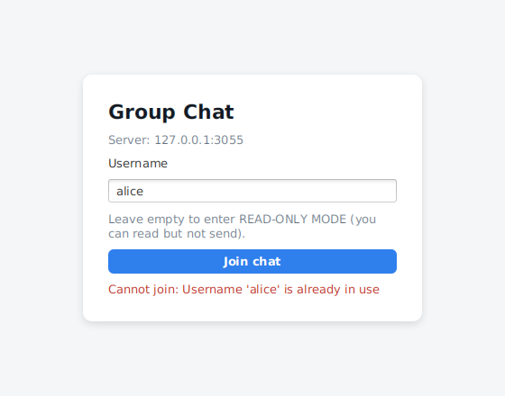

# Multi-Client Chat Application (Java Sockets + JavaFX)

Mini Project 1 - a group chat built on **TCP sockets**. A central server distributes every message to all
connected clients; each side has a **JavaFX** GUI (`GridPane` layout + CSS). The server serves clients
concurrently with **Java 21 virtual threads**, and the socket logic (Model) is completely independent of the
JavaFX interface (View).

| Project | What it is | Start command |
|---|---|---|
| [`TCPServer`](TCPServer) | Server + monitoring window (live log, coloured user list) | `java TCPServer` |
| [`TCPClient`](TCPClient) | Chat client (login screen + chat window) | `java TCPClient <ServerIPAddress> <PortNumber>` |

## Screenshots

| Login | Chat (Alice) | READ-ONLY MODE |
|---|---|---|
|  |  |  |

| Server monitor (log + coloured users) | `allUsers` reply (Bob only) | Duplicate username |
|---|---|---|
|  |  |  |

## Features

**Client**
- Username screen before the chat. **Empty username -> READ-ONLY MODE** (can read, cannot send; input is disabled and a badge is shown).
- Send with the **SEND** button or **Enter**.
- `allUsers` returns the list of active users **to that client only**.
- Disconnect by typing `end` or `bye`, or with the **LEAVE** button; the server is notified and everyone else sees "X left the chat".
- Header shows an **Online** label with a green status circle.
- Messages are shown as `[HH:mm:ss] sender: text`; your own messages are highlighted, system notices are italic.

**Server**
- Accepts many concurrent clients - **one virtual thread per connection**.
- Formats each message with sender and time and distributes it to every active connection.
- `ListView` of connected users, each with a **random background colour**.
- Activity log: `Server Started`, `Waiting for Client...`, `Welcome [User]`, messages, disconnects.
- Usernames are unique (case-insensitive) and limited to 1-20 chars of letters, digits, `_`, `-`, `.`.

## Architecture

Both applications follow **Model - View - Controller** with strict separation of concerns:

```
chat.model        Sockets, protocol, threads. NO JavaFX imports.      (ChatServer, ClientHandler, ChatClient)
chat.view         JavaFX GridPane layouts only. NO socket code.       (ServerView, LoginView, ChatView)
chat.controller   Listens to the model, updates the view on the FX thread
chat.config       Loads *.properties
```

The model talks to the outside world only through a listener interface (`ServerListener`, `ClientListener`).
The controller implements it and hops to the JavaFX thread with `Platform.runLater`. Because of this the
server model is unit-tested **headless** (no display) - proof that the view can be replaced without touching the logic.

UML (sources in [`docs/uml`](docs/uml), rendered PNGs next to them):

| Diagram | File |
|---|---|
| Class diagram - server | [`class-diagram-server.png`](docs/uml/class-diagram-server.png) |
| Class diagram - client | [`class-diagram-client.png`](docs/uml/class-diagram-client.png) |
| Deployment diagram | [`deployment-diagram.png`](docs/uml/deployment-diagram.png) |
| Sequence diagram (join, chat, allUsers, leave) | [`sequence-diagram.png`](docs/uml/sequence-diagram.png) |
| Use case diagram | [`usecase-diagram.png`](docs/uml/usecase-diagram.png) |

### Wire protocol

One UTF-8 text line per message, fields separated by `|`.

| Direction | Line | Meaning |
|---|---|---|
| C -> S | `JOIN\|name` | Join; empty name = read-only guest |
| C -> S | `MSG\|text` | Chat message |
| C -> S | `ALLUSERS` | Ask for active users |
| C -> S | `BYE` | Leave |
| S -> C | `OK\|name\|readOnly` | Join accepted (always the first reply) |
| S -> C | `ERR\|reason` | Join rejected / command refused |
| S -> C | `SYS\|text` | Welcome, joined, left notices |
| S -> C | `MSG\|HH:mm:ss\|sender\|text` | Broadcast chat message |
| S -> C | `USERS\|a,b,c` | Reply to `ALLUSERS` (requester only) |

## Requirements

- **JDK 21** or newer (virtual threads are final in 21)
- **Maven 3.9+**
- IntelliJ IDEA (any recent version) - *File > Open* the `pom.xml` of each project

## Build

```bash
./build-all.sh            # Linux / macOS   (Windows: build-all.bat)
# or per project:
cd TCPServer && mvn clean package     # -> TCPServer/target/TCPServer.jar  (+ server.properties)
cd TCPClient && mvn clean package     # -> TCPClient/target/TCPClient.jar  (+ client.properties)
```

The JARs are "fat" (shaded) and include JavaFX. JavaFX ships OS-specific native code, so **build the JARs on the
operating system you will run them on** (or build on each OS).

## Run

```bash
# 1) Server (reads server.properties, default port 3000)
cd TCPServer/target
java -cp TCPServer.jar TCPServer            # same as: java -jar TCPServer.jar

# 2) One or more clients
cd TCPClient/target
java -cp TCPClient.jar TCPClient localhost 3000
java -jar TCPClient.jar 192.168.1.20 3000   # from another machine on the LAN
```

From the IDE / without building a JAR: `mvn javafx:run` (server) and
`mvn javafx:run -Djavafx.args="localhost 3000"` (client). In IntelliJ create a run configuration with main class
`TCPClient` and program arguments `localhost 3000`.

## Configuration (no recompilation needed)

| File | Keys | Notes |
|---|---|---|
| `server.properties` | `server.bindAddress` (default `0.0.0.0`), `server.port` (default `3000`) | Put next to the JAR (working directory) to override the bundled copy |
| `client.properties` | `server.host` (default `localhost`), `server.port` (default `3000`) | Command-line arguments `<ip> <port>` override the file |

Lookup order: file in the working directory -> copy bundled in the JAR -> built-in defaults.

## Tests

```bash
cd TCPServer && mvn test
```

`ChatServerTest` starts the real server on a random port and talks to it with raw sockets: join, read-only
guests, duplicate/invalid usernames, broadcast with sender + time, `allUsers` privacy, `bye`, and 50 concurrent clients.

## Project structure

```
TCPServer/  pom.xml  config/server.properties
  src/main/java/TCPServer.java                      main()
  src/main/java/chat/{ServerApp, config, model, view, controller}
  src/main/resources/{server.css, server.properties}
  src/test/java/chat/model/ChatServerTest.java
TCPClient/  pom.xml  config/client.properties
  src/main/java/TCPClient.java                      main()
  src/main/java/chat/{ClientApp, config, model, view, controller}
  src/main/resources/{client.css, client.properties}
docs/       uml/ (PlantUML sources + PNG), screenshots/, DEMO_SCRIPT.md, BLOG_POST.md, SUBMISSION_CHECKLIST.md
```

## Design notes and known limitations

- `TCPServer` / `TCPClient` do **not** extend `Application`; they call `Application.launch(...)`. This is what lets the
  shaded JAR start without the "JavaFX runtime components are missing" error.
- `OK` is sent *before* a client is added to the broadcast list, so it is always the first line a client receives.
- Broadcasts are written synchronously per client; one extremely slow client could delay others (a per-client outbound queue would fix this).
- Traffic is plain text over TCP: no encryption and no passwords - "authentication" here means choosing a unique identity.
- Messages are single-line (line breaks are replaced by spaces).
